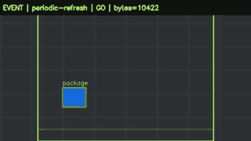
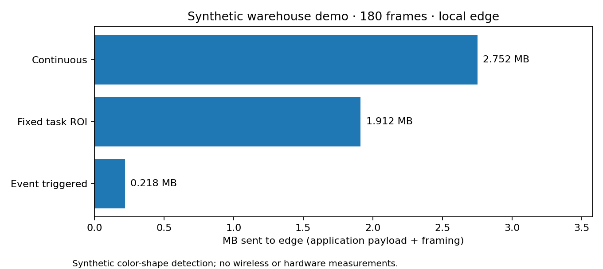
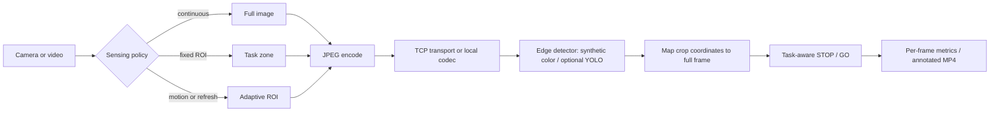

# Task-Centric Robotic Perception · Event-Triggered Edge Offloading

**A reproducible robotics perception prototype** that compares continuous video offloading, fixed task-ROI offloading, and event-triggered task-relevant ROI offloading. It is motivated by the *RWTH Aachen INDA Priority HiWi Program: Task-Centric Robotic Perception and Recognition in Mobility and Production*.



> **Status: engineering prototype (synthetic benchmark).** The default demo detects colored geometric objects in a generated warehouse video. It does **not** demonstrate real-world deep learning accuracy, real robot deployment, an event camera, or 6G. Optional Ultralytics YOLO and real TCP communication paths are provided but require separate evaluation.

## Sample results — synthetic data only



One local run on the generated 180-frame video produced ~2.75 MB (`continuous`),
~1.91 MB (`roi`) and ~0.22 MB (`event`) of sent application data (**92.1% fewer
bytes** than continuous). The event policy offloaded 73/180 frames, achieved 100%
STOP decision recall **on this synthetic scene**, but had 12 extra STOP frames
and only 37.0% framewise fresh-detection recall because most frames were not
inferred. These are **illustrative measurements**, not generalized accuracy,
latency, hardware performance or real-world safety evidence. Rerun the benchmark
to obtain machine-specific timing values.

## Architecture



## Quick start (Python 3.10+; no GPU, network, or external data required)

```bash
python -m venv .venv
# macOS/Linux: source .venv/bin/activate
# Windows: .venv\\Scripts\\activate
python -m pip install -e '.[test,plots]'
tc-perception generate
tc-perception benchmark
tc-perception render --mode event
pytest -q
```

Generated assets (ignored by Git):

- `examples/generated/warehouse_synthetic.mp4`: 180-frame toy warehouse video with motion, idle periods and a stationary obstacle.
- `examples/generated/warehouse_synthetic.jsonl`: exact per-frame obstacle and package boxes.
- `results/benchmark_summary.json`, `results/benchmark_summary.csv`: comparison with machine and methodology notes.
- `results/per_frame.jsonl`: ROI, trigger reason, detected boxes, latency, bytes and STOP/GO for every frame.
- `results/event_annotated.mp4`: visual explanation of triggers, ROI and decision.

The benchmark prints a traffic reduction percentage **measured on your machine and these inputs**. No performance result is claimed in advance. Read [experimental protocol](docs/EXPERIMENTS.md) before interpreting the numbers.

## Edge TCP demo (two terminals, local loopback by default)

Terminal 1:

```bash
tc-perception serve --host 127.0.0.1 --port 8765 --detector color
```

Terminal 2:

```bash
tc-perception stream --video examples/generated/warehouse_synthetic.mp4 --mode event
```

For **two trusted machines on the same Wi-Fi LAN**, bind the server to its LAN interface and set `--host` on the client to the server's IP. TCP is plain-text and unauthenticated; **do not expose it to the public internet**. TCP send length reports application payload and frame header, not total wire-level bandwidth. For meaningful network timing, time per-frame client round trip under controlled Wi-Fi profiles. `benchmark` always uses a simulated *local* edge and is not a two-device network benchmark.

## Optional real visual model: YOLO

```bash
python -m pip install -e '.[yolo]'
tc-perception benchmark --detector yolo --model yolov8n.pt --gt examples/generated/warehouse_synthetic.jsonl
# For a real recorded video without synthetic ground truth:
tc-perception benchmark --video your_video.mp4 --gt no_annotations.jsonl --detector yolo
```

Model weights may need to download on first run. COCO YOLO labels (`person`, `car`, ...) do not match the synthetic `obstacle` target, so **do not interpret synthetic GT precision/recall from a YOLO run as model accuracy**. To evaluate YOLO on real data, provide corresponding human annotations and update `hazard_labels`/metrics to the chosen task classes. The synthetic color detector is intentionally trivial and exists to exercise the complete systems pipeline offline.

## Optional ROS 2 observation publishing

With ROS 2 `rclpy` and `std_msgs` installed and the environment sourced:

```bash
tc-perception ros2-publish --mode event
ros2 topic echo /perception/task_status  # in a separate terminal
```

This adapter publishes frame-level `STOP`/`GO` **observations**, not motor commands. ROS 2 itself is not bundled or tested in core CI. See [ROS 2 notes](docs/ROS2.md).

## Task decisions and safety

For a synthetic obstacle class or selected COCO classes (person, car, truck, bicycle, motorcycle), a detection sets the demonstrative decision to `STOP`; after no further detections it persists for a bounded number of frames, and a full task-zone refresh with no hazard clears it. `GO` is *not* a robot safety certification. The trigger looks at every RGB frame and skips network/detector work when uninteresting; it does not save image sensor acquisition power. A periodic full-zone refresh attempts to re-detect stationary hazards but is not a fail-safe mechanism.

## Repository layout

```text
src/tc_perception/
  sensing.py       motion trigger + periodic refresh + ROI geometry
  detectors.py     synthetic color demo / optional Ultralytics YOLO
  transport.py     JPEG codec, TCP client, threaded edge server
  pipeline.py      crop to global boxes, hazard state and task decisions
  benchmark.py     same-frame three-way experiments and outputs
  synthetic.py     deterministic video + JSONL ground truth
  visualize.py     diagnostic annotated video
  cli.py           generate / benchmark / render / serve / stream / ros2-publish
  ros2_bridge.py   optional ROS 2 String/JSON observations (not motor control)
examples/          generated assets directory (ignored)
tests/             unit and TCP integration tests
docs/EXPERIMENTS.md experimental limitations and extension protocol
.github/workflows/ci.yml
```

## Relevance to the INDA HiWi description

- **Task-centric perception:** fixed aisle zone and relevance-filtered image regions.
- **Event-triggered sensing:** motion-based activation plus periodic task-zone refresh.
- **Robotic vision / recognition:** pluggable detector with optional real YOLO inference.
- **Edge intelligence / communications:** image ROI compression, local-edge simulation and a real TCP server/client.
- **End-to-end quantitative evaluation:** per-frame traffic, processing latency, STOP/GO quality and failure diagnostics.

**Missing / planned real-world validation:** robot-mounted sensor integration, true event-camera streams, Wi-Fi on two physical devices, hardware energy measurement, physical ROS 2 hardware/middleware validation, and annotated real industrial scenes. These are explicit future milestones rather than accomplishments attributed to this version.

## Licence
MIT.
